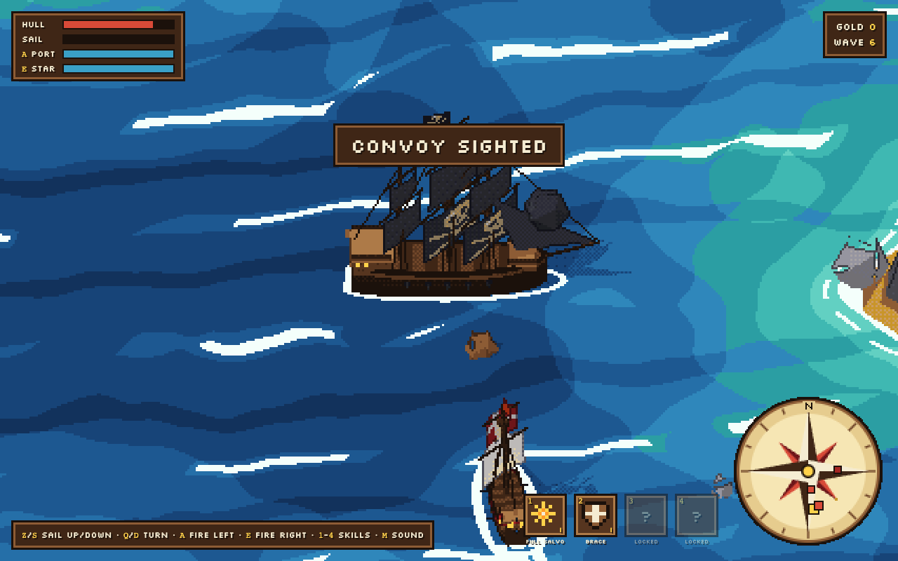

# Broadside

Pixel-art pirate naval combat in the browser, built with Three.js. Pick a ship, survive waves of navy ships, sink merchants for gold, board crippled enemies and level up your skills.



## Run

ES modules need an HTTP server (opening `index.html` from disk won't work):

```sh
npx serve .        # or: python3 -m http.server
```

Then open the printed URL. Three.js loads from jsDelivr, so there's no install step.

## Online (2-4 players)

Peer-to-peer, no server to run: on the ship select screen, one player clicks **HOST CO-OP** or **HOST PVP** and shares the 4-letter room code; the others type it and click **JOIN**, then everyone picks a ship. The host presses `Enter` to set sail (co-op) or start the match (PvP).

- **Convoy** (solo or co-op: set the **GAME** button to CONVOY before picking a ship or hosting): its own long map between two ports, forts on the way. Each round a merchant convoy sails port to port with its escort: guards that stay beside the merchants, hunters that come for you. The round ends when every merchant is sunk, captured or in port. Gold that reaches port buys a bigger escort for the next convoys.
- **Co-op**: shared gold, bigger waves, each pirate picks their own refit cards; a sunk pirate comes back at the next break, the run ends when the whole crew is sunk.
- **PvP**: first to 10 sinkings (or most after 5 min). Each sinking refits the winner; merchants keep coming as loot (their barrels patch your hull).
- Online there's no pause and no boarding QTE: only ships under 20% hull (striking their colours) can be boarded.
- The host's browser runs the game: keep that tab in front (a hidden tab stalls the game for everyone until the host comes back).

### How two distant PCs connect

Home PCs sit behind a router (NAT) that drops unsolicited incoming connections, so neither browser can simply "call" the other. WebRTC, built into every browser, gets around it in three steps. [PeerJS](https://peerjs.com) wraps them in a few calls:

```
        1. signalling (public PeerJS server)
     ┌──────────► 0.peerjs.com ◄──────────┐
     │     "I am broadside-DVZL"          │
  Host                                  Guest
     ◄═════════ 3. direct link ═════════►
     │                                    │
     └──► 2. STUN (Google) ◄──────────────┘
          "what's my public address?"
```

1. **Signalling: finding each other.** The host registers on the free PeerJS server under `broadside-` + the room code. The guest asks the same server to connect it to that id. The server only relays a few setup messages; no game traffic goes through it.
2. **STUN: learning your public address.** Each browser asks a STUN server (`stun.l.google.com`), which answers with the address it sees from outside. Both sides swap these candidate addresses through the signalling server.
3. **Hole punching.** Both browsers send packets to each other's public address at the same time. Each router sees an outgoing packet first, so it lets the other side's packets in as "replies". The result is a direct, encrypted (DTLS) data channel between the two PCs. Direct also means each player sees the others' public IP address, so share a room code only with people you would give that to.

When hole punching fails (strict or symmetric NATs, some corporate or mobile networks), traffic goes through a **TURN relay** instead. PeerJS ships with free community TURN servers (`eu-0` / `us-0.turn.peerjs.com`) in its default config, so this works out of the box, though with no guarantee. For something more reliable, pass your own `iceServers` to `new Peer(...)` in `net.js` (Cloudflare Calls, Metered, or a self-hosted coturn).

All of it is free: STUN answers once per connection (a few bytes), and signalling is a handful of messages. Only TURN carries real traffic, and only when the direct link fails.

### What goes over the wire

The host runs the whole simulation; guests are thin clients:

- **Guest → host**: input (`{t: 'in', turn, fireL, fireR}` when it changes) and actions (`sail`, `skill`, `board`, `card`, `ship`), plus a ping every second. The host clamps everything it receives.
- **Host → guests, 20×/s**: a snapshot with ships (compact arrays), cannonballs, loot, kegs, the fort, game state and HUD data for each pirate. It also carries the one-shot effects of the last 50 ms (hits, splashes, muzzle flashes, popups, sounds). JSON with numbers rounded to 0.01, a few KB per snapshot.
- Guests draw one snapshot behind and glide each value between the last two, so movement stays smooth at 60 fps. Sounds are replayed relative to the guest's own ship.
- If either side hears nothing for 8 s, the link is dropped: a guest who leaves sinks, and guests go back to the lobby if the host leaves.

## Controls

Keys are physical positions, so AZERTY (ZQSD) and QWERTY (WASD) both work. AZERTY labels shown:

| Key | Action |
|---|---|
| `Z` / `S` | Sail up / down |
| `Q` / `D` | Turn |
| `A` / `E` | Fire port (left) / starboard (right) broadside |
| `1`–`4` | Skills |
| `Space` | Board nearby ship |
| `C` | Toggle overview zoom |
| `M` | Mute |
| `P` | Pause |

## Features

- Three player ships, progressive waves, destructible fort, islands that block cannonballs
- Skill bar (4 slots, learn and level up between waves)
- Merchant convoys, gold pickup with magnet, combo multiplier (×2 to ×5)
- Boarding: automatic under 20% hull, otherwise a timing QTE; crew losses and recruits
- Procedural music and SFX, local top-10 leaderboard

## Code

| File | Role |
|---|---|
| `sim.js` | Pure game simulation (no rendering) |
| `game.js` | Main loop, input, HUD, game state, online host snapshots / guest rendering |
| `net.js` | P2P transport (PeerJS): rooms, messages, heartbeat |
| `ships.js`, `world.js`, `water.js`, `fx.js` | Three.js scene: ships, islands, sea, effects |
| `post.js`, `palette.js` | Pixel post-processing and palette |
| `radar.js` | Compass / radar |
| `sfx.js` | Sound effects and procedural music |
| `check.mjs` | Assertions on the sim: `node check.mjs` |
| `qa/` | QA screenshots |

Ideas backlog (in French): [`ideas.md`](ideas.md).
